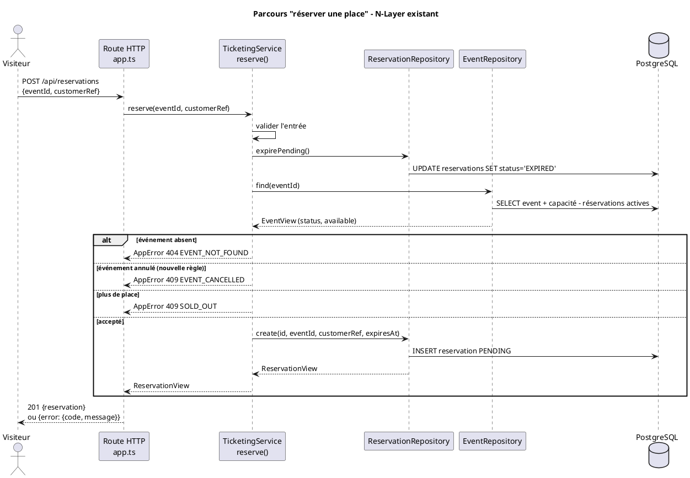

# TP 2 — Diagnostiquer et améliorer le monolithe N-Layer

**Règle traitée :** un événement annulé ne doit plus accepter de nouvelle demande de place.

## 1. Chemin réel du parcours « réserver une place »

Parcours choisi : `POST /api/reservations` avec `{ "eventId": "...", "customerRef": "..." }`.

| Étape | Couche | Fichier | Rôle |
| --- | --- | --- | --- |
| 1 | Présentation (HTTP) | `src/app.ts` (route `POST /api/reservations`) | Lit le JSON, extrait `eventId` et `customerRef`, renvoie `201` et la réservation |
| 2 | Service (métier + orchestration) | `src/services/TicketingService.ts` → `reserve()` | Valide l'entrée, déclenche l'expiration, lit l'événement, décide (annulé, complet), calcule l'expiration, crée la réservation |
| 3 | Persistance | `src/repositories/ReservationRepository.ts` → `expirePending()` | Passe en `EXPIRED` les réservations en attente dépassées (écriture SQL) |
| 4 | Persistance | `src/repositories/EventRepository.ts` → `find()` | Lit l'événement et **calcule la disponibilité en SQL** à partir des réservations |
| 5 | Persistance | `src/repositories/ReservationRepository.ts` → `create()` | Insère la réservation `PENDING` |
| 6 | Base | PostgreSQL : tables `events`, `reservations` | Stocke les données |
| 7 | Présentation (erreurs) | `src/app.ts` → `setErrorHandler` | Transforme une `AppError` en réponse JSON avec son code HTTP ; autre erreur → `503` |

Intégrations : aucune sur ce parcours (le simulateur de paiement n'intervient qu'au checkout).

**Objets métier et modèles techniques**

| Type | Exemples | Remarque |
| --- | --- | --- |
| Objets métier (vocabulaire) | Événement, Réservation, Disponibilité | N'existent pas comme classes : ils sont représentés par des vues |
| Vues échangées entre couches | `EventView`, `ReservationView` (`src/types.ts`) | Servent à la fois de modèle métier et de format de réponse JSON |
| Modèles techniques | `EventRow`, `ReservationRow` (lignes SQL), requêtes Fastify, `AppError` | `AppError` porte un **code HTTP** et est levée par le service |

## 2. Localiser la décision et mesurer le changement

**Où est la décision :** `TicketingService.reserve()`, entre la lecture de l'événement et la création de la réservation. L'information nécessaire (`status`) était déjà lue par `EventRepository.find()` mais jamais utilisée.

**Test de comportement écrit avant le changement** (`tests/api.test.ts`) :
« Une demande sur un événement annulé reçoit `409 EVENT_CANCELLED`, aucune réservation n'est enregistrée et la disponibilité affichée ne change pas. »

Avant le changement : **7 tests passent, 1 échoue** (la demande était acceptée avec `201`).
Après le changement : **8 tests passent sur 8.**

**Mesure du changement**

| Élément | Nombre | Détail |
| --- | --- | --- |
| Fichiers de code modifiés | 1 | `src/services/TicketingService.ts` |
| Lignes de code ajoutées | 1 | une condition dans `reserve()` |
| Méthodes touchées | 1 | `reserve()` |
| Fichiers de données | 1 | `db/seeds/001_demo.sql` : événement `concert-annule` (`CANCELLED`) |
| Fichiers de tests | 1 | `tests/api.test.ts` : 1 test ajouté, 7 inchangés |
| Documentation | 1 | `README.md` : nouveau code d'erreur `EVENT_CANCELLED` |
| Dépendances nouvelles | 0 | aucune |
| Fichiers à lire pour comprendre | 7 | `app.ts`, `TicketingService.ts`, `EventRepository.ts`, `ReservationRepository.ts`, `types.ts`, `errors.ts`, `001_init.sql` |

Le changement est petit à écrire, mais il a fallu lire 7 fichiers pour être sûr de son effet.

**Contrat observable préservé :** même route, même forme d'erreur `{ error: { code, message } }`, même code `409` que `SOLD_OUT`. Seul un nouveau code d'erreur apparaît. Un événement ouvert garde ses conditions habituelles (tests existants inchangés et verts).

## 3. À quelle couche appartient la règle, et pourquoi

La règle est placée dans la **couche service**, dans `reserve()`.

- C'est une **décision métier** : accepter ou refuser une demande de place selon l'état de l'événement. Elle doit s'appliquer quel que soit le point d'entrée (API, interface, futur traitement).
- **Pas dans la route** (`app.ts`) : la présentation ne doit que traduire HTTP ; une autre entrée contournerait la règle.
- **Pas dans le repository** : filtrer en SQL (`WHERE status = 'OPEN'`) ferait répondre « événement introuvable » (`404`) au lieu de « événement annulé ». La décision serait cachée dans la persistance.
- **Pas dans l'interface web** : elle peut être contournée en appelant l'API directement.
- Elle est vérifiée **avant** la capacité : un événement annulé est refusé même s'il reste des places.

## 4. Dérive du N-Layer observée

**Dérive principale : le service connaît le protocole HTTP.**
`TicketingService` lève `new AppError(409, ...)` : la couche métier choisit elle-même les codes HTTP (`400`, `404`, `409`, `410`). La nouvelle règle a dû suivre ce modèle. Conséquence : la décision métier « événement annulé » et sa traduction HTTP sont mélangées ; réutiliser `reserve()` hors HTTP garderait des codes HTTP sans sens.

Autres dérives relevées :

- **Responsabilité excessive** : `TicketingService` gère catalogue, réservation, expiration et paiement (voir TP 1).
- **Règle métier dans la persistance** : la disponibilité (« quelles réservations retiennent une place ») est calculée en SQL dans `EventRepository`, et l'expiration est répétée dans `ReservationRepository.expirePending()`.
- **Dépendance cachée / effet de bord** : chaque lecture (`listEvents`, `getEvent`) écrit dans la table des réservations via `expirePending()`.
- **Détail technique dans le métier** : `reserve()` contient une pause d'atelier (`reservationHoldMs`) au milieu de la décision.

## 5. Ce qui reste difficile à tester ou à faire évoluer

- **Tester la règle seule est impossible** : le test passe par HTTP et une vraie base PostgreSQL. `TicketingService` dépend de repositories concrets ; on ne peut pas lui donner un événement annulé en mémoire.
- **La règle n'est pas protégée en concurrence** : l'événement est lu, puis la réservation créée, sans transaction. Un événement annulé entre ces deux étapes accepterait encore une demande (même faiblesse que la dernière place).
- **Aucune action ne permet d'annuler un événement** : il faut modifier la base à la main.
- **Les réservations déjà existantes ne sont pas traitées** : un événement annulé garde ses réservations `PENDING`, qui peuvent encore être payées ; les `CONFIRMED` ne sont pas remboursées.
- **L'interface ne connaît pas la règle** : le bouton « Réserver » reste actif sur un événement annulé (il est désactivé seulement quand `available` vaut 0). Le refus arrive après le clic, avec le message de l'API. Ajouter la règle dans l'interface la dupliquerait.
- **Prochaine évolution** : le TP 3 (utilisateurs) ajoutera de nouvelles décisions dans `reserve()`, qui accumule déjà validation, expiration, statut, capacité et création.
