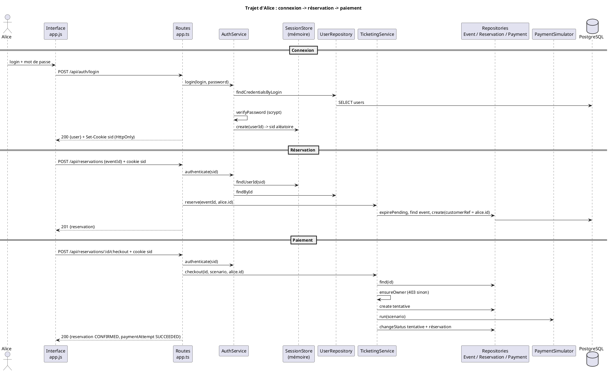

# TP 3 — Authentification et achat connecté dans le N-Layer

**Règle :** seul un utilisateur authentifié peut acheter un billet, et uniquement à partir de sa propre réservation.

## 1. Le monolithe avant le changement

### Chemin d'exécution actuel (fin du TP 2)

**Créer une réservation**

```text
public/app.js  reserve(eventId)  lit le champ #customer-ref choisi par le navigateur
  -> POST /api/reservations { eventId, customerRef }
src/app.ts  route POST /api/reservations  extrait eventId et customerRef du corps
  -> TicketingService.reserve(eventId, customerRef)
       valide l'entrée, ReservationRepository.expirePending(), EventRepository.find(eventId),
       refuse si absent (404), annulé (409 EVENT_CANCELLED) ou complet (409 SOLD_OUT),
       ReservationRepository.create(id, eventId, customerRef, expiresAt)
  -> PostgreSQL : INSERT INTO reservations (... customer_ref ...)
  <- 201 { reservation }
```

**Confirmer l'achat**

```text
public/app.js  clic "Confirmer l'achat"
  -> POST /api/reservations/:id/checkout { scenario }
src/app.ts  route checkout  extrait scenario
  -> TicketingService.checkout(id, scenario)
       valide id et scénario, expirePending(), ReservationRepository.find(id),
       refuse si absente (404), expirée (410) ou fermée (409),
       PaymentAttemptRepository.create(...)  ->  PaymentSimulator.run(scenario)
       -> changeStatus de la tentative puis de la réservation
  <- 200 { reservation, paymentAttempt }
```

### Réponses

1. **Qui fournit le `customerRef` ?** Le navigateur, à partir d'un champ libre. Un autre client HTTP (curl, script) peut envoyer n'importe quelle valeur, y compris la référence de quelqu'un d'autre.
2. **Où décide-t-on qu'une réservation peut être créée et payée ?** Dans `TicketingService.reserve()` et `TicketingService.checkout()`, à partir de l'événement et de l'état de la réservation uniquement.
3. **Une réservation connaît-elle son auteur ? Le checkout le vérifie-t-il ?** Elle stocke un `customerRef` déclaratif, non prouvé. Le checkout ne le compare à rien : toute personne qui connaît l'identifiant peut consulter et payer.
4. **Que manque-t-il pour une connexion réelle ?** Un objet Utilisateur persistant (identifiant, login unique, mot de passe haché), une vérification du mot de passe, une session côté serveur, un cookie, et un lien vérifié entre la réservation et son propriétaire.
5. **Dépendances à préparer pour tester un refus d'achat ?** L'application Fastify complète, une base PostgreSQL migrée et alimentée, les trois repositories et le simulateur : `TicketingService` reçoit ses dépendances, mais ce sont des classes concrètes reliées à la base.

### Carte fonctionnelle avant / après

```plantuml
@startuml
title Modèle fonctionnel - avant (TP 2)
hide methods
class Evenement { titre\nlieu\ndate\ncapacite\nstatut : OPEN | CANCELLED }
class Reservation { customerRef (texte libre)\nstatut\nexpireLe }
class TentativePaiement { scenario\nstatut }
Evenement "1" -- "0..*" Reservation
Reservation "1" -- "0..*" TentativePaiement
@enduml
```

```plantuml
@startuml
title Modèle fonctionnel - après (TP 3)
hide methods
class Evenement { titre\nlieu\ndate\ncapacite\nstatut : OPEN | CANCELLED }
class Utilisateur { id\nlogin (unique)\npasswordHash }
class Reservation { customerRef = id de l'utilisateur\nstatut\nexpireLe }
class TentativePaiement { scenario\nstatut }
class Session <<technique, en mémoire>> { id opaque\nuserId\nexpireLe }

Evenement "1" -- "0..*" Reservation
Utilisateur "1" -- "0..*" Reservation : possède >
Reservation "1" -- "0..*" TentativePaiement
Utilisateur "1" -- "0..*" Session : est reconnu par >

note right of TentativePaiement
  Seul le propriétaire de la réservation
  peut déclencher une tentative
end note
note bottom of Session
  Mécanisme technique, pas un objet métier :
  permet au serveur de reconnaître les requêtes
end note
@enduml
```

### Ce que la nouvelle capacité oblige à changer, couche par couche

| Couche | À ajouter ou modifier |
| --- | --- |
| Interface (`public/`) | Formulaire de connexion, compte courant, déconnexion ; suppression du champ `customerRef` ; boutons de réservation désactivés sans session |
| Routes HTTP (`src/app.ts`) | Plugin cookie ; routes `login`, `me`, `logout` ; lecture de la session sur les routes protégées ; transmission de l'utilisateur au service |
| Services (`src/services/`) | Nouveau `AuthService` (connexion, reconnaissance de session) ; `TicketingService` reçoit l'utilisateur et vérifie le propriétaire |
| Sessions et sécurité (`src/sessions/`, `src/security/`) | Stockage des sessions en mémoire avec expiration ; hachage `scrypt` des mots de passe |
| Repositories (`src/repositories/`) | Nouveau `UserRepository` ; `ReservationRepository` inchangé (le `customerRef` reçoit l'identifiant du compte) |
| Données (`db/`, `src/migrate.ts`) | Migration `002_users.sql` ; `migrate.ts` exécute la nouvelle migration et crée Alice et Bob |
| Tests (`tests/`) | Connexion avant chaque action protégée ; nouveau fichier `auth.test.ts` ; défi de concurrence avec deux comptes connectés |

## 2. La règle et ses conséquences

- **Authentification** (qui fait la demande ?) : `AuthService.authenticate()` à partir du cookie de session.
- **Autorisation** (cette personne peut-elle agir sur cette réservation ?) : `TicketingService.ensureOwner()` compare l'auteur de la réservation à l'utilisateur courant.

| Route | Accès | Refus |
| --- | --- | --- |
| `GET /api/events`, `GET /api/events/:id` | public | — |
| `POST /api/reservations` | connecté ; l'auteur est l'utilisateur de la session | `401 AUTH_REQUIRED` |
| `GET /api/reservations/:id` | connecté et propriétaire | `401 AUTH_REQUIRED`, `403 RESERVATION_FORBIDDEN` |
| `POST /api/reservations/:id/checkout` | connecté et propriétaire | `401 AUTH_REQUIRED`, `403 RESERVATION_FORBIDDEN` |

Les règles antérieures restent : événement annulé (`409`), complet (`409`), réservation expirée (`410`), fermée (`409`), paiement refusé, résultat incertain.

**Ordre des vérifications au checkout :** session (`401`) → identifiant et scénario valides (`400`) → réservation existante (`404`) → propriétaire (`403`) → état (`410`/`409`) → seulement alors création de la tentative et appel au simulateur.

## 3. Inventaire des changements

| Fichier | Statut | Pourquoi |
| --- | --- | --- |
| `db/migrations/002_users.sql` | nouveau | Table `users` (id, login unique, password_hash) |
| `src/migrate.ts` | modifié | Exécute aussi `002_users.sql` et crée Alice et Bob avec un hash |
| `src/security/passwords.ts` | nouveau | `hashPassword` / `verifyPassword` avec `scrypt` et sel aléatoire |
| `src/repositories/UserRepository.ts` | nouveau | Lecture des comptes en base |
| `src/sessions/SessionStore.ts` | nouveau | Sessions en mémoire, identifiant aléatoire, expiration, horloge remplaçable |
| `src/services/AuthService.ts` | nouveau | Connexion, reconnaissance de session, déconnexion |
| `src/services/TicketingService.ts` | modifié | `reserve`, `getReservation`, `checkout` reçoivent `userId` ; nouvelle méthode `ensureOwner` |
| `src/app.ts` | modifié | Cookie, routes d'authentification, routes protégées, configuration de session |
| `src/server.ts` | modifié | `SESSION_TTL_MINUTES`, `COOKIE_SECURE` |
| `src/types.ts` | modifié | `UserView` |
| `public/index.html`, `public/app.js`, `public/app.css` | modifiés | Connexion, compte courant, déconnexion ; plus de `customerRef` |
| `tests/helpers.ts` | nouveau | Comptes de test, connexion par la vraie route |
| `tests/api.test.ts` | modifié | Les 8 parcours antérieurs se connectent avant d'agir |
| `tests/auth.test.ts` | nouveau | 10 tests des droits |
| `tests/concurrency.challenge.ts` | modifié | Les deux demandes viennent d'Alice et Bob connectés |
| `package.json`, `package-lock.json` | modifiés | `@fastify/cookie` ; script `test` lance les deux fichiers l'un après l'autre |
| `README.md` | modifié | Comptes, routes, codes d'erreur, limite des sessions |

**Total : 20 fichiers (7 nouveaux, 13 modifiés), 1 nouvelle table, 1 nouvelle dépendance, 3 méthodes métier modifiées + 1 ajoutée.**

Au TP 2, une règle sur un objet existant touchait 1 fichier de code. Ici, une règle sur un **nouvel objet** traverse toutes les couches : l'identité naît dans l'interface (connexion), est portée par HTTP (cookie), reconnue par un service (session), stockée en base (compte) et utilisée par la décision métier (propriétaire).

## 4. Preuves par les tests

Commande : `docker compose --profile test run --build --rm test` → **18 tests, 18 réussis**.

| Scénario | Test | Résultat |
| --- | --- | --- |
| Visiteur non connecté consulte le catalogue | `un visiteur non connecté consulte le catalogue` | ✔ `200` |
| Visiteur non connecté réserve, consulte ou paie | `un visiteur non connecté ne peut ni réserver ni payer` | ✔ `401 AUTH_REQUIRED`, aucune réservation ni tentative ajoutée |
| Mauvais mot de passe ou login inconnu | `un mauvais mot de passe est refusé sans créer de session` | ✔ `401 INVALID_CREDENTIALS`, aucun cookie |
| Cookie protégé, pas de secret dans la réponse | `la connexion renvoie un cookie de session protégé…` | ✔ `HttpOnly`, `SameSite=Lax`, `Path=/`, pas de hash |
| Alice réserve et paie | `Alice se connecte, réserve et paie avec succès` | ✔ auteur = Alice, `CONFIRMED`, `SUCCEEDED` |
| Alice envoie l'identifiant de Bob dans le corps | `un auteur envoyé dans le corps ne remplace pas…` | ✔ auteur enregistré = Alice |
| Bob consulte ou paie la réservation d'Alice | `Bob ne peut ni consulter ni payer…` | ✔ `403`, réservation toujours `PENDING`, 0 tentative |
| Cookie absent, modifié, forgé ou expiré | `un cookie absent, modifié ou expiré est refusé` | ✔ `401` (expiration simulée avec une horloge contrôlable, +31 min) |
| Ancien cookie après déconnexion | `après déconnexion, l'ancien cookie ne fonctionne plus` | ✔ `204` puis `401` |
| Sessions distinctes | `les sessions d'Alice et de Bob sont distinctes` | ✔ |
| Parcours antérieurs (paiement, refus, lenteur, expiration, annulé, complet, erreurs) | 8 tests de `api.test.ts` | ✔ avec Alice ou Bob connectés |

Défi de concurrence (`npm run test:challenge`) : échoue toujours **volontairement** (« Deux demandes ont été acceptées (2) pour une seule place »), désormais avec Alice et Bob connectés.

## 5. Prendre du recul

### Trajet d'Alice, de la connexion à l'achat confirmé



### Inventaire des services et fonctions

| Élément | Nature | Responsabilité | Lit / écrit | Dépendances concrètes |
| --- | --- | --- | --- | --- |
| Routes `app.ts` | transport HTTP | Lire le cookie et le corps, appeler les services, traduire les erreurs, poser/retirer le cookie | cookie `sid`, corps JSON | Fastify, `@fastify/cookie`, `AuthService`, `TicketingService` |
| `AuthService.login` | orchestration + décision | Vérifier les identifiants, ouvrir une session | lit `users`, écrit une session | `UserRepository`, `SessionStore`, `verifyPassword`, `AppError` (HTTP 401) |
| `AuthService.authenticate` | mécanisme de session | Reconnaître l'utilisateur d'une requête | lit la session et `users` | `SessionStore`, `UserRepository` |
| `SessionStore` | mécanisme de session | Créer, retrouver, expirer, supprimer des sessions | `Map` en mémoire | `crypto.randomBytes`, horloge |
| `passwords.ts` | sécurité technique | Hacher et vérifier un mot de passe | — | `crypto.scrypt` |
| `UserRepository` | stockage | Lire les comptes | table `users` | `pg.Pool` |
| `TicketingService.reserve` | décision métier + orchestration | Accepter une demande de place pour un utilisateur | `events`, `reservations` | repositories concrets, `AppError` |
| `TicketingService.ensureOwner` | décision métier (autorisation) | Vérifier que la réservation appartient au demandeur | réservation déjà lue | `AppError` (HTTP 403) |
| `TicketingService.checkout` | décision + orchestration | Vérifier propriétaire et état, lancer le paiement, mettre à jour | `reservations`, `payment_attempts` | repositories, `PaymentSimulator` |
| `migrate.ts` | stockage / démarrage | Créer les tables et les comptes de démonstration | toutes les tables | `pg`, `hashPassword`, fichiers SQL |

### Réponses

1. **Fichiers changés et pourquoi** : voir l'inventaire (20 fichiers). La règle a besoin d'une identité **prouvée** : elle doit être saisie (interface), transportée (cookie), reconnue (session), stockée (compte) et comparée (service). Chaque couche porte un morceau de ce trajet.
2. **Qui vérifie quoi ?** Le mot de passe : `AuthService.login` avec `verifyPassword`. La session : `AuthService.authenticate` avec `SessionStore`. La propriété de la réservation : `TicketingService.ensureOwner`.
3. **Pourquoi retirer `customerRef` de l'interface ne suffit pas ?** L'interface n'est qu'un client parmi d'autres : un appel `curl` peut toujours envoyer un corps arbitraire. Seule l'API peut garantir l'auteur, en ignorant le corps et en prenant l'identité de la session (prouvé par le test « un auteur envoyé dans le corps… »).
4. **Dépendances pour tester « Bob paie la réservation d'Alice »** : l'application Fastify complète avec le plugin cookie, une base PostgreSQL migrée avec les deux comptes hachés, `SessionStore`, `AuthService`, `TicketingService` et ses trois repositories et le simulateur ; il faut se connecter deux fois par HTTP et créer une réservation réelle. Impossible de tester `ensureOwner` seul : il est privé et la réservation ne peut venir que de la base.
5. **Qui connaît quoi ?**
   - PostgreSQL : les trois repositories, `UserRepository`, `migrate.ts` ; les tests interrogent aussi la base directement.
   - Cookies : uniquement `app.ts` (bon point) ; mais le nom du cookie est aussi utilisé par les tests.
   - Hachage : `passwords.ts`, utilisé par `AuthService` et par `migrate.ts`.
   - Règles mélangées à ces détails : `AuthService` et `TicketingService` lèvent des `AppError` avec des **codes HTTP** (401, 403) ; la règle de propriété repose sur le champ technique `customerRef` ; la disponibilité reste calculée en SQL.
6. **Couplages inquiétants** :
   - **Connexion** : passer à un fournisseur externe (OAuth) toucherait `AuthService`, les routes et l'interface ; `TicketingService` ne dépend que d'un `userId` (couplage faible).
   - **Sessions** : passer à plusieurs processus impose un stockage partagé ; `SessionStore` est une classe concrète créée dans `buildApp`.
   - **Stockage** : `TicketingService` dépend des classes concrètes de repositories ; `customerRef` sans clé étrangère mélange anciennes références fictives et identifiants de comptes.
   - **Paiement** : `checkout` appelle directement `PaymentSimulator` ; un vrai prestataire changerait le cœur de la décision d'achat.

### Difficultés observées (pour le TP 4)

- Tester une décision d'autorisation exige HTTP, cookies, sessions et PostgreSQL : il n'existe aucun point d'entrée pour tester la règle seule.
- `TicketingService` grossit encore : validation, expiration, statut d'événement, capacité, propriété, paiement.
- Les codes HTTP restent décidés par la couche service (`AppError(403, …)`).
- `buildApp` construit lui-même toutes les dépendances concrètes ; seul l'horloge des sessions a pu être rendue remplaçable.
- Les tests partagent une seule base : les fichiers de test doivent s'exécuter l'un après l'autre (`--test-concurrency=1`).

### Limites connues

- Sessions en mémoire : un redémarrage déconnecte tout le monde ; impossible avec plusieurs processus.
- Les réservations créées avant le TP 3 portent des références fictives : elles n'appartiennent à aucun compte et deviennent inaccessibles (`403`).
- Pas de clé étrangère `reservations.customer_ref → users.id`, pour ne pas casser les anciennes données.
- `404` puis `403` : un utilisateur peut savoir qu'une réservation d'un autre existe.
- Aucune limitation du nombre d'essais de connexion ; un login inconnu répond plus vite qu'un mauvais mot de passe (pas de hachage factice).
- La protection CSRF repose sur `SameSite=Lax` ; pas de jeton dédié.
